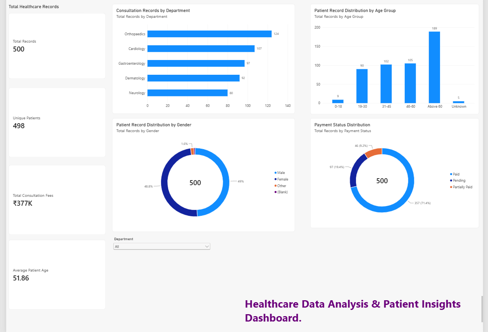
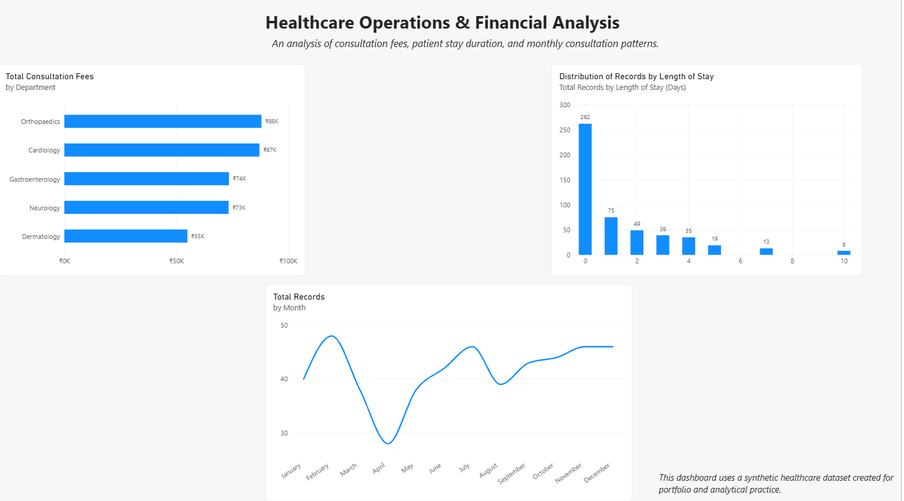

# healthcare-data-analysis-patient-insights
Healthcare analytics project using Excel, SQL Server and Power BI to analyse synthetic patient consultation data.
# Healthcare Data Analysis & Patient Insights

An end-to-end healthcare analytics portfolio project using **Microsoft Excel, SQL Server and Power BI**.

## Project Overview

This project analyses 500 synthetic healthcare consultation records to explore patient demographics, departmental activity, consultation fees, payment patterns and length of stay.

The objective is to demonstrate how data analytics tools can be applied to healthcare-related datasets to generate descriptive insights and support data-driven operational understanding.

## Tools & Technologies

- Microsoft Excel – Data inspection and preparation
- Power Query – Data cleaning and transformation
- SQL Server – Data querying, cleaning and analysis
- Power BI – Interactive dashboards and visualisation
- DAX – Measures and calculated columns

## Dataset Details

- Total records: 500
- Unique Patient IDs: 498
- Total columns: 9
- Dataset type: Synthetic

## Analysis Performed

- Patient demographics and age-group analysis
- Department-wise consultation distribution
- Consultation fee analysis
- Payment status distribution
- Length-of-stay analysis
- Monthly consultation trends
- Data quality and repeated ID checks

## Key Findings

- Orthopedics recorded the highest consultation count (124).
- The average patient age was approximately 51.86 years.
- Payment status included 357 Paid, 97 Pending and 46 Partially Paid records.
- Neurology had the highest average consultation fee (approximately ₹917).
- 262 records had a length of stay of zero days.
- February recorded the highest consultation volume in the dataset.

## Power BI Dashboard

The interactive dashboard contains two pages:

1. Patient Insights Overview
2. Healthcare Operational Analysis

## Project Limitations

- The dataset is synthetic and does not represent actual hospital records.
- Findings are descriptive and do not establish clinical or causal relationships.
- Results are limited to the variables available in the dataset.
### Dashboard Preview

**1. Patient Insights Overview**

**2. Healthcare Operational Analysis**

## Author

**Nishita Hazarika**  
MSc Biochemistry

*Healthcare Analytics Portfolio Project | 2026*
